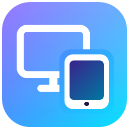

<p align="center">
  
</p>

<h1 align="center">PlexiChore</h1>

<p align="center">
  <b>Turn any Android tablet into a portable monitor for your Windows PC or Mac.</b><br>
  Extend · Primary · Mirror — with touch and S-Pen, over USB or Wi-Fi.
</p>

<p align="center">
  <a href="https://github.com/pntapps/plexichore/releases"></a>
  
  <a href="LICENSE"></a>
</p>

<p align="center">
  <a href="https://plexichore.pntapps.com/download/windows"></a>
  <a href="https://plexichore.pntapps.com/download/mac"></a>
  <a href="https://plexichore.pntapps.com/download/android"></a>
</p>

<p align="center">
  <a href="https://github.com/pntapps/plexichore/releases">All releases</a> ·
  <a href="#features">Features</a> ·
  <a href="#using-it">How to use</a> ·
  <a href="#quick-start">Build from source</a>
</p>

<p align="center">
  
</p>

**Developed by [PNT Apps](https://www.pntapps.com)** · Free software under [GPL-3.0](LICENSE) with attribution terms ([NOTICE](NOTICE)).

## Three ways to use your tablet

<p align="center">
  
</p>

- **Extend** — the tablet is a second screen next to yours; drag windows onto it.
- **Primary** — the tablet becomes the main display (taskbar / menu bar move to it); your layout comes back when you disconnect. On Windows, with no monitor plugged in, the tablet is the main screen automatically.
- **Mirror** — the tablet shows the same picture as one of your screens.

## How it works

<p align="center">
  
</p>

The computer runs a small host app that creates a virtual monitor (Windows: the signed open-source Virtual Display Driver; macOS: built in), captures it and streams hardware-encoded H.264 to the tablet (TCP 47800). Touch, S-Pen and keyboard input flow back. Connect with a USB cable (`adb reverse`, set up for you) or over Wi-Fi with automatic discovery (UDP 47801) and a one-time 4-digit pairing code.

## Download

These links always download the newest version:

| You have | Download |
|---|---|
| Windows 10 (1809+) / 11 PC | **[Installer](https://plexichore.pntapps.com/download/windows)** · [portable exe](https://plexichore.pntapps.com/download/windows-portable) (no install) |
| Mac (macOS 13+, Apple Silicon or Intel) | **[DMG](https://plexichore.pntapps.com/download/mac)** (notarized) |
| Android tablet (Android 8+) | **[APK](https://plexichore.pntapps.com/download/android)** |

Release notes, checksums and older versions are on the **[Releases](https://github.com/pntapps/plexichore/releases)** page.

Install the host on the computer and the app on the tablet, then see [Using it](#using-it).

## Repository layout

| Folder | What | Status |
|---|---|---|
| [`PlexiChore/`](PlexiChore) | Android tablet app (Kotlin, Jetpack Compose, Material 3) | ✅ Working, tested on Galaxy Tab S8 |
| [`PlexiChore-Desktop/`](PlexiChore-Desktop) | Windows host: .NET 10 WPF tray app + streaming engine + tools | ✅ Working, tested on Windows 10 19045 |
| [`PlexiChore-Mac/`](PlexiChore-Mac) | macOS host: Swift / SwiftUI menu-bar app | ✅ Working, tested on macOS 27 (Apple Silicon) with a Galaxy Tab S8 |
| [`PROTOCOL.md`](PROTOCOL.md) | Wire protocol shared by all three — the contract | Authoritative |
| [`ROADMAP.md`](ROADMAP.md) | What is left, known limits, cleanup | Start here for next work |
| [`CLAUDE.md`](CLAUDE.md) | Guide for Claude Code sessions continuing this project | |

## Features

- **Three modes:** Extend (virtual second monitor), Primary (tablet becomes the main display; original layout restored on disconnect, crash-safe), Mirror (any existing monitor).
- **Portrait:** rotating the tablet switches the virtual monitor to a portrait mode (1600×2560 etc.).
- **Auto scaling:** the tablet's virtual monitor gets a scale matching the tablet's density (200 % on a Tab S8); make text larger or smaller with **− / +** in the tablet's stream controls or Settings → Display size.
- **Low latency:** hardware H.264 (NVENC/QuickSync/AMF via Media Foundation, software and MJPEG fallbacks), Qualcomm/Exynos/MediaTek low-latency decoders, vsync-aligned frame pacing, sub-second connect.
- **Transports:** USB cable (adb reverse, auto-applied by the desktop app; USB tethering supported), Wi-Fi with automatic discovery and 4-digit pairing, manual IP.
- **Input:** multi-touch, S-Pen (pressure/tilt/hover/barrel/eraser), touch-as-mouse mode, scroll.
- **Compatibility:** Android 8–17, phones to 14.6" tablets, foldables, DeX, Fire OS (no Google services), decoder capability negotiation with fallback chain.
- **Safety net:** an emergency key releases the tablet display instantly if anything goes wrong (Mac: **⌃⌥⌘D**); Primary hands the main display back on disconnect, quit or crash.
- **Help built in:** troubleshooting pages in the tablet app and in the Mac app (Help page + menu bar).

### Mac host specifics
- Virtual display via macOS's `CGVirtualDisplay` (no driver to install); VideoToolbox hardware H.264.
- **Lid closed:** optional *Keep the tablet on with the lid closed* (Extended display → Options; charger connected) lets the tablet stay your only screen.
- Distributed as a notarized, universal (Apple Silicon + Intel) DMG — outside the Mac App Store, because it uses a private display API and input injection.
- Needs Screen Recording, Accessibility and Local Network permissions on first launch.

Measured on Galaxy Tab S8 + GeForce GT 710 over USB: ~60 fps desktop/cursor motion in all modes, 51–55 fps full-screen video in extend (GPU-limited), ~3 ms RTT, 0.4–1 s tap-to-picture.
Measured on Galaxy Tab S8 + MacBook Air (Apple Silicon, macOS 27) over USB with H.264: ~58 fps cursor motion, 3–15 ms RTT, ~0.4–1.6 s tap-to-picture.

## Quick start

### Windows host
Requirements: Windows 10 1809+ (tested 19045), .NET 10 SDK to build.
```powershell
cd PlexiChore-Desktop
dotnet build PlexiChore.slnx -m:1
dotnet test  PlexiChore.slnx
powershell -File publish.ps1          # → dist\PlexiChore.exe (self-contained, single file)
```
Run `dist\PlexiChore.exe` (lives in the tray). For **Extend/Primary** click *Extended display → Install* once (installs the signed open-source [Virtual Display Driver](https://github.com/VirtualDrivers/Virtual-Display-Driver), one UAC prompt). See [`PlexiChore-Desktop/README.md`](PlexiChore-Desktop/README.md) and [`PlexiChore-Desktop/driver/README.md`](PlexiChore-Desktop/driver/README.md).

### Android app
Requirements: Android Studio / JDK 17+ (Android Studio's JBR works), Android SDK 37.
```bash
cd PlexiChore
./gradlew assembleDebug
adb install -r app/build/outputs/apk/debug/app-debug.apk
```

### Mac host
Requirements: macOS 13+ to run; Xcode 15+ / Swift 5.9+ toolchain to build (tested with Swift 6.4 on macOS 27).
```bash
cd PlexiChore-Mac
swift build && swift test                     # or open Package.swift in Xcode
./scripts/build-app.sh                        # → build/PlexiChore.app (dev-signed)
# release: Developer ID + notarization
SIGN_IDENTITY="Developer ID Application: …" UNIVERSAL=1 ./scripts/build-app.sh
SIGN_IDENTITY="Developer ID Application: …" ./scripts/package-dmg.sh
./scripts/notarize.sh build/PlexiChore-<version>.dmg   # needs the 'plexichore-notary' keychain profile
```
See [`PlexiChore-Mac/README.md`](PlexiChore-Mac/README.md).

## Using it

1. Start PlexiChore on the computer — Windows: the tray app (*Start with Windows* in Settings); Mac: open the DMG, drag PlexiChore to Applications, open it and grant Screen Recording, Accessibility and Local Network (*Open at login* in Settings).
2. **USB:** enable *USB debugging* on the tablet, plug in, accept the prompt. **Wi-Fi:** same network; approve the 4-digit code on the computer the first time.
3. Open PlexiChore on the tablet, pick **Extend / Primary / Mirror**, tap **Connect**.
4. While streaming: swipe down from the top edge or 3-finger tap for controls (disconnect, **− / +** display size, touch mode, stats).
5. **If the screen ever looks wrong:** Mac — press **⌃⌥⌘D** (or menu bar → *Release Extended Display*); Windows — disconnect from the tray. Both apps have a Help page with more fixes.

## Known limits
See [`ROADMAP.md`](ROADMAP.md#known-limits). Highlights: full-screen video is GPU-limited on weak GPUs; the Windows virtual display driver needs a short (≤ ~48) mode list; on the Mac, rotation and scale changes re-create the virtual display (~1 s blank) and the host is not App Store eligible. Still to verify by hand: pinch, two-finger scroll/right-click, S-Pen pressure on the Mac, sleep/wake, an Intel Mac.

## Credit to PNT Apps — required
If you use, fork, modify or redistribute PlexiChore, you must keep the credit to PNT Apps:
- in your README or main documentation: "Developed by PNT Apps — https://www.pntapps.com", and
- inside each app, where users can see it (for example an About or Settings screen): "Developed by PNT Apps" linking to https://www.pntapps.com.

You may add your own credits next to it. This is an additional term of the license (GPL-3.0, section 7(b)); see [NOTICE](NOTICE).

A modified version must not be presented as the original PlexiChore, and the names "PNT Apps" and "PlexiChore" and their logos/icons may not be used as the name or icon of your app.

## License
Copyright © 2026 PNT Apps.

PlexiChore — the Android app, the Windows host and the macOS host — is licensed under the GNU General Public License v3.0 ([LICENSE](LICENSE)) with the additional attribution terms in [NOTICE](NOTICE).

In short: you may use, study, change and share PlexiChore, but if you distribute it or a modified version, you must release your source code under the same GPL-3.0 license (including the attribution terms) and keep the credit to PNT Apps.

Third party: fonts (Inter, Space Grotesk) are under the SIL Open Font License 1.1; Android libraries under Apache 2.0; Windows libraries under MIT. The Virtual Display Driver (MIT), nefcon (BSD-3) and adb are downloaded at install time, not bundled — see [NOTICE](NOTICE) and `PlexiChore-Desktop/driver/README.md`.
